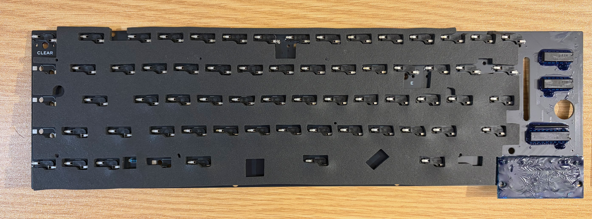

# Build Assembly Guide

Before Assembly, you will need to purchase and source certain 
parts. Please See the separate [Component List](./COMPONENTS.md)
for the required parts.

## PCB

The first part of assembly is the PCB

Notes when assembling the PCB
* All the components (except the power LED) are soldered to the back of the PCB.
* The power LED is considered optional, it can be omitted if not required.
* If using PCB mounted stabilisers (not in BOM) these need to be attached to the PCB.
* You can use IC sockets (or not) based on your preference.

I suggest using the FFC ribbon cable to attach the keyboard to the main board,
but a standard 20 pin header can also be used. Neither of these is in the BOM

Once assembled the keyboard PCB can be tested by inserting a couple of keyswitches
and connecting to a Model 1. It doesnt need all the keyswitches to work.

## Internal Frame

The (3D Printed) internal frame mounts to 5 keyboard case mount points,
and additionally it is supported from underneath by 3 central mounting posts.

The full internal frame cannot be printed on a typical size 3D Printer and
has been broken into 2 pieces using a connecting dovetail joint. You need 
need a bed size of 180mm to print this.
The internal frame can be printed in any material (I used PLA), since the part
is quite thick, and well-supported in the case.

Once Printed you need to assemble the 2 parts together. 
The dovetail is tapered, and can only be joined in one way.
Ideally CA glue or epoxy should be used when joining the 2 parts.

Then 8x Brass M2 heat set inserts need to be installed into the frame.
These are for the for the PCB to be screwed to.

## Main Assembly

Assembly of the keyboard is done in layers. Order of assembly

### Foam Layer Under PCB

In the donar keyboard the foam layer was stuck to PCB back using adhesive

* The main keyboard PCB itself, ensure it is fully assembled first.
* Use short M2 screws to attach the PCB to the internal frame.
* Thin cotton/plastic isolation layers, that sit under (and isolate PCB) from the switches.
* Thick main sound deadening Poron Isolation Foam.
* The keyboard plate, including plate mounted key stabilisers.
* Key switches installed through plate into sockets.
* Key switches are required to secures the plate and the foam layers undeneath
* Finally, the Keycaps can be attached.

When installing each layer you need to ensure that foam layers are
trimmed fit within the outline of the PCB, so the sit down inside the brim of the internal frame;
and holes are added to allow PCB mounting screws to be used.

Surrounding the PCB area is a brim which the keyboard plate rests on.
This provides support to the keys via the plate, removing stress on the PCB.
While the plate rests on the brim, it should not extend over it, and may need to be trimmed.

A cutout in the plate may be needed to allow Power LED (if installed).

When attaching the PCB to the frame (using M2 bolts), they should be very lightly
tightened. The screws are just to locate the PCB, leaving them loose will allow
The PCB to move, and improve sound quality.

## Bezel

The bezel has a different aesthetic, to the traditional TRS-80 bezel.

Printing was done without supports, with the top of the bezel facing the build plate,
this means you can achieve a pattern based on the texture of the build plate used.

The Bezel cannot be printed on a regular size 3d Printer,
and has been broken into 2 pieces using dowels to connect the 2 parts.

