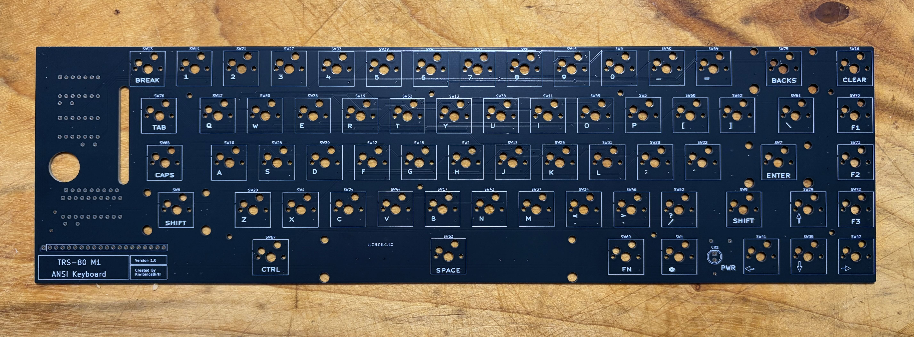
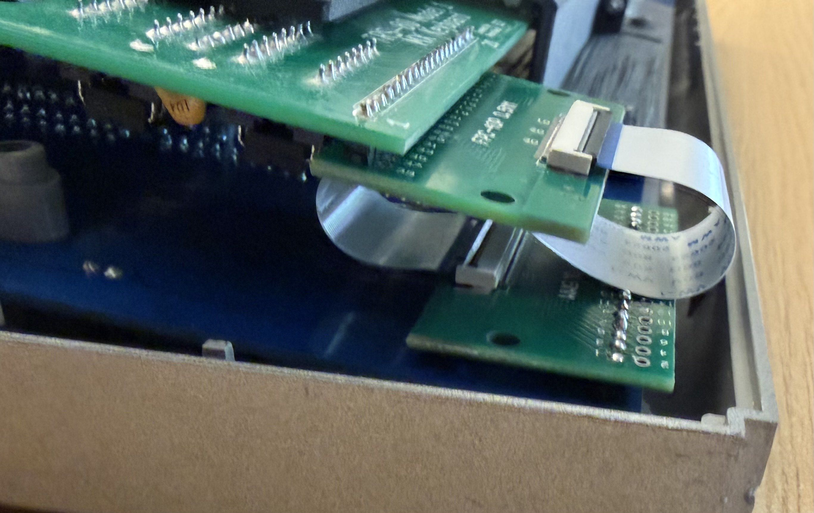
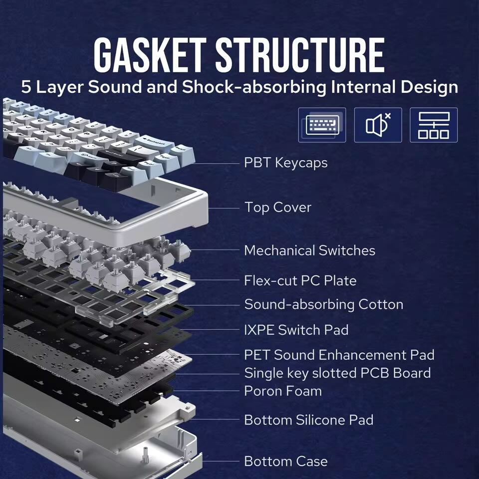

# Components

## Keyboard PCB

This will need to be purchased produced via standard PCB production houses.

The Gerber Files are located here [Gerber Files](./pcb)

## PCB Components

These components need to be purchased. Items marked as (*) are optional

| Reference       | Description                        | Quantity |
|-----------------|------------------------------------|----------|
| C1-C3           | Capacitor 100nf Disk ThruHole P5mm | 3        |
| CR1             | LED 3mm_P2.54mm                    | 1 *      |
| J1              | PinHeader_1x20_P2.54mm             | 1        |
| R1              | Resistor 4K7 Array ThruHole SIP9   | 1        |
| R2              | Resistor 300R 1/4w ThruHole Axial  | 1 *      |
| SW2 - SW76      | Hotswap_Kailh_MX                   | 59       |
| SW67, SW69-SW72 | Hotswap_Kailh_MX                   | 5 *      |
| Z1, Z2          | 74LS05 DIP                         | 2        |
| Z3              | 74LS240 DIP                        | 1        |

### FFC Cable

This is link to the boards, most important is to get 40 pin, and 0.5mm socket. 
Many sellers have them. 

[Aliexpress FFC Adapter Board](https://www.aliexpress.com/item/1005007617729176.html)

For the cable (pictured) is 40P, 0.5MM, 100mm, Type A from this link. 

[Aliexpress FFC Adapter Board](https://www.aliexpress.com/item/1005008319529888.html)

When installed the cable should look like this. I used odd numbered pins 1-39

## Keyboard Parts

For the keyboard itself you will need to source the following
* MX Keycaps, with style matching your needs.
* MX Key Switches (minimum 59), any brand and type (but not low profile) will do.
* MX Key Stabilisers, either PCB or Plate mounted are supported.
* Keyboard Plate (67 key) compatible with the chosen stabilisers.
* (Optional) Keyboard foam layers for cushioning and noise isolation.

There are 2 options to purchase these components
* Source the components separately from one or more suppliers.
* Purchase a suitable donor keyboard that contains all the components.

### Separate Purchase

If purchasing separately you need to find compatible (keyboard layout) components.
While the Keycaps and key switches are interchangeable between most keyboards
There are some small exceptions like key width e.g. spacebar is 6.25U (wide).

In terms of stabilisers there are 2 types PCB mounted (Cherry) and Plate mounted.
In either case you need to get a Plate that supports these stabilisers, 
and suitable stabilisers. The PCB is suitable for either type.

I have uncovered several DIY keyboards that have the same basic layout, and
Could be used to source the custom plate and foam kits.
* Tofu65 v3
* Bakeneko65 v3
* Neo65
* Zen65
* Lucky65

### Donor Keyboard

For my build I choose the “Epomaker Alua F65 (Blue)” keyboard.
At the time of writing it is listed as $65 USD (on official website),
but can be found cheaper depending on where you buy it.

[epomaker-aula-f65](https://epomaker.com/products/epomaker-aula-f65)

The big advantage with this keyboad as it contains many of the parts you will need

Of course any keyboard can be used, the most important thing is to
look for a hot-swappable keyboard with the matching key arrangement.
Pay careful attention to the bottom row, and right column).

The only slight disadvantage of this keyboard was it didn’t have a “Home”
(to replace Clear) key so I choose to use the “Delete” key instead.

## 3D Printed Parts

The 3d Printed Parts are provided in 3MF format, and were printed on a Bambu X2D

### Keyboard Frame

[Keyboard Frame](./parts/Keyboard%20Base%20Version%203.3mf)

### Bezel

[Keyboard Bezel](./parts)

## Other Parts

In addition to the components required to build the PCB you will need
to source the following mounting hardware
* (8x) M2 bolts to mount the PCB
* (8x) M2 heat set inserts.

