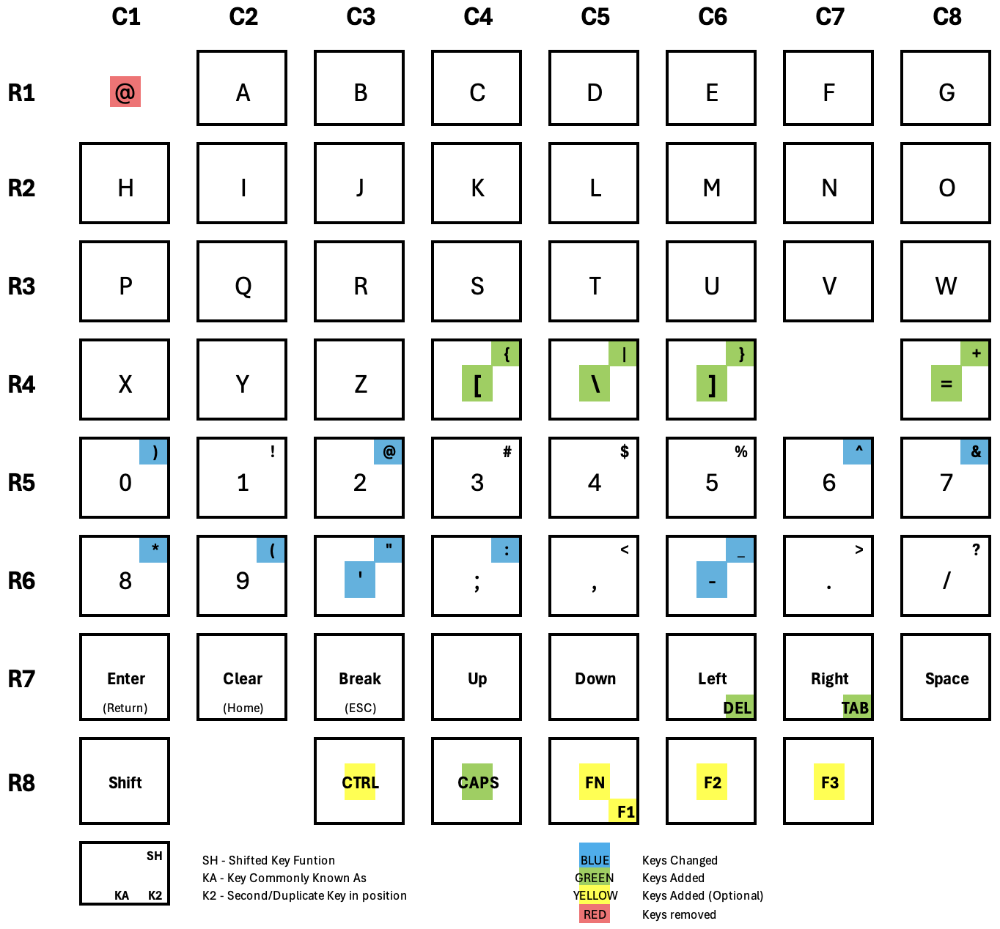

# Modern TRS-80 Model 1 Keyboard

## Introduction

This is a modern take on a TRS-80 Model 1 Keyboard.
It provides and identical (mostly) layout familiar to most people, 
And is based on a modern mechanical keyboard design.

The main features are:

* Uses standard ANSI (US) keyboard layout.
* Follows the 65% standard keyboard design.
* Uses MX key switches and standard keycaps
* Utilises hot-swappable key switches.
* Has standard 20 pin connector suitable for existing motherboards.
* Supports either PCB (Cherry) or Plate mounted stabilisers.
* Optional CTRL, CAPS, FN, F1, F2, F3 keys with suitable software

A modern mechanical keyboard is built in layers the following is a 
Explosion of a modern typical keyboard

## Keyboard Layout

The keyboard layout is based on the 65% (67 key) keyboard layout. 
This is similar to a keyboard on a laptop without the function key row.
The keyboard design utilises 64 of these keys, 5 of which are optional.

Most keys have 1 to 1 replacements on the modern keyboard except for 
the Break, and Clear keys. I chose to use the ESC and Home keys as 
substitutes. You can get custom key caps, but this is not required

Also there are two duplicate keys Left and Right arrow keys are 
mapped to Delete, and Tab keys.

The CAPS Lock Key has no matching function in the TRS-80 and needs
a specific driver to be supported.
Optional Keys for Ctrl, Fn, F1, F2, F3, can also be installed
these also need custom software to use them.

An upgraded Level 2 ROM provides support for the modified key mappings
e.g. several shifted number keys map to different symbols. This is
compatible with most operating systems.

## Components Provided

What is provided as part of this project

* 3D Printed keyboard base plate, internal mounting frame.
* 3D Printed Model 1 case top bezel.
* Keyboard PCB with standard 20 pin connector.
* Level 2 ROM supporting changed key mappings.

## Build Guide

See the separate [Build Guide](BUILDING.md) for detailed instruction.

## Software

Provided by Rev 1.4 ROM replacement [Model 1 Level 2 Rev 1.4 ROM](rom/MDL1REV4.bin)

The source code is available in the [TRS-80-ROMS](https://github.com/kiwisincebirth/TRS-80-ROMS) repository.

## Matrix

This is the amended keyboard Matrix

## Limitations

* No dedicated @ Key, it has been removed replaced with Shift-2.
* Any software that provides its own KB driver, may have issues with the modified layout.
* Euro or British keys are not supported e.g. $ vs GBP poind sign.
* This design still has the ghost keys design flaw. This could be fixed with modified PCB

## Credits

* Marcus Erz for his MX keyboard design, which this project referenced during the design phase.
This includes the PCB design which this project used as a starting point. 

